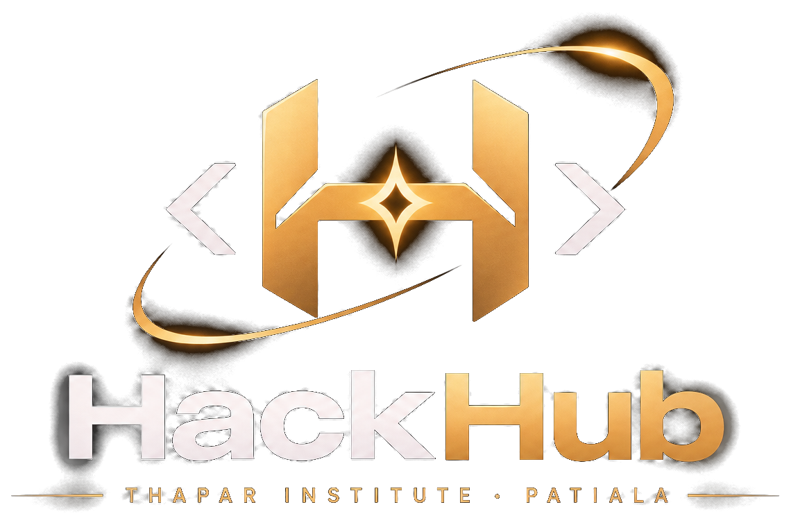

<div align="center">
  
  <h1>⚡ HackHub</h1>
  <p><strong>The Premier Student Hackathon Intelligence, Teammate Matchmaking & Local AI Platform</strong></p>

  [](https://github.com/BhavyaKansal20/HackHub)
  [](https://ollama.com)
  [](./LICENSE)
  [](https://www.thapar.edu)
</div>

---

**HackHub** is a production-grade hackathon discovery, talent matchmaking, and AI copilot system designed specifically for collegiate developers and builders. It automatically aggregates 100% verified hackathons across **10 premier platforms** (Devfolio, Unstop, Devpost, Hack2Skill, HackerEarth, Major League Hacking, Reskilll, HackIndia, HackerRank, and All Hackathons), pairs students with ideal teammates based on complementary skill sets, and integrates **HACKBOT** — an on-premise local LLM engine that computes LinkedIn-style match scores, synthesizes winning system architectures, and auto-drafts official institutional On-Duty (OD) attendance exemption applications.

---

## 🎯 Key Capabilities

| Feature | Description | Implementation |
|---|---|---|
| **10-Platform Aggregator** | Real-time ingest of student hackathons with zero dummy/broken links | Multi-source ingest engine with 15-min auto-refresh cadence |
| **HACKBOT Local Copilot** | Sovereign on-premise AI copilot across every screen | Powered locally by Ollama (`qwen2.5:3b`/`7b`) via Apple Silicon MLX |
| **Developer DNA Blueprint** | Analyzes public GitHub signals, repo stars & declared skills | Automated archetype classifier, seniority tier & radar scores |
| **AI Fit Matchmaker** | Calculates personalized /100 match against hackathon judging criteria | Jaccard token overlap + local semantic evaluation |
| **HACKBOT AI Architect** | Generates 3 winning project blueprints per hackathon | System data flows, track USPs, and modern full-stack tech stacks |
| **Official TIET OD Drafter** | Generates compliant attendance exemption letters for DoSA & HODs | Formatted official letter template with 1-click clipboard export |
| **Team Builder Hub** | Post open roles, review candidates & privately share contact details | PostgreSQL relational models + Supabase Realtime subscriptions |
| **Obsidian Glass Aesthetic** | Polished UI with custom dark glassmorphism & gold accents | Tailwind CSS v4 + Radix UI + Lucide Icons |

---

## 🏗️ System Architecture

```
HackHub/
├── public/
│   ├── HackHubLogo.png               ← Wide transparent master logo
│   └── site.webmanifest              ← PWA manifest & campus metadata
├── src/
│   ├── components/
│   │   ├── hub/
│   │   │   ├── HackBotWidget.tsx     ← Universal floating local AI copilot
│   │   │   ├── HackathonCard.tsx     ← Unstop-style poster card layout
│   │   │   ├── SiteHeader.tsx        ← Universal navbar with auth state
│   │   │   └── SiteFooter.tsx        ← Institutional footer & contacts
│   │   └── ui/                       ← Clay & obsidian glass UI primitives
│   ├── lib/
│   │   ├── ai.server.ts              ← Local HACKBOT service with zero-fail fallback
│   │   ├── hub.functions.ts          ← TanStack Start server functions (RPC)
│   │   ├── hackathons.ts             ← Ingest, caching & query management
│   │   └── hackathons-catalog.ts     ← 10-platform verified catalog
│   └── routes/
│       ├── __root.tsx                ← Global shell with HackBot copilot mount
│       ├── index.tsx                 ← Flagship hackathons exploration portal
│       ├── hackathons.$id.tsx        ← Multi-tab detail view & AI Architect
│       └── _authenticated/
│           ├── profile.tsx           ← Developer DNA blueprint & photo crop
│           └── team-builder.tsx      ← Teammate matchmaking & AI pitch generator
└── supabase/
    └── migrations/                   ← PostgreSQL schemas & Row Level Security
```

---

## 🤖 HACKBOT: Local AI Engine

HackHub uses **no external closed APIs** for its core intelligence. All inference runs directly on your machine through **Ollama** or any OpenAI-compatible runner:

- **Primary Engine:** Local LLM daemon (`http://127.0.0.1:11434/v1`) using `qwen2.5:3b` or `qwen2.5:7b`.
- **Dynamic Auto-Discovery:** Automatically detects whichever model is installed in your local Ollama daemon.
- **Resilient Fallback:** Zero-fail deterministic heuristic engine ensures the app never crashes even if Ollama is offline.
- **Privacy Standard:** Never transmits student roll numbers, passwords, or personal credentials outside `localhost`.

---

## ⚙️ Quick Start & Local Setup

### 1. Prerequisites
- **Node.js** v20+ or **Bun** v1.2+ (Bun recommended)
- **Homebrew** (macOS) or package manager of choice
- **Ollama** for local AI inference

### 2. Clone the Repository
```bash
git clone https://github.com/BhavyaKansal20/HackHub.git
cd HackHub
bun install
```

### 3. Setup Local AI (Ollama)
```bash
# Start Ollama background service
brew services start ollama

# Pull recommended model
ollama pull qwen2.5:3b
```

### 4. Configure Environment Variables
Create `.env.local` from `.env.example`:
```bash
cp .env.example .env.local
```

Ensure your Supabase and local AI variables are configured:
```env
VITE_SUPABASE_URL="https://your-project.supabase.co"
VITE_SUPABASE_ANON_KEY="your-anon-key"
LOCAL_AI_URL="http://127.0.0.1:11434/v1"
LOCAL_AI_MODEL="qwen2.5:3b"
```

### 5. Run Database Migrations & Seeds
```bash
bun run seed
```

### 6. Start the Development Server
```bash
bun dev
```
Open **[http://localhost:8080](http://localhost:8080)** (or the port displayed in your terminal) in your browser.

---

## 🧪 Production Build & Verification

To verify full TypeScript compilation and static asset generation:
```bash
bun run build
```

To preview the production bundle locally:
```bash
bun run preview
```

---

## 🛡️ Security & Privacy Invariants

- **Campus Authentication:** Restricts authenticated write operations to verified `@thapar.edu` Google OAuth accounts.
- **On-Duty Letter Integrity:** Verifies registered teams against active hackathon registries before stamping OD attendance slips.
- **Contact Privacy:** Personal student contact information (phone numbers, personal emails) remains completely masked in Team Builder until the team owner explicitly accepts an application.

---

## 📜 Contributing & Community

We welcome contributions from student developers, designers, and open-source enthusiasts!
Please review our guides before submitting pull requests:
- 📖 [Contributing Guidelines](./CONTRIBUTING.md)
- 🤝 [Code of Conduct](./CODE_OF_CONDUCT.md)
- 🔒 [Security Policy](./SECURITY.md)

---

## 📄 License

This project is licensed under the **MIT License** — see the [LICENSE](./LICENSE) file for full details.

---

## 🇮🇳 Built with Pride for Student Builders

**HackHub** was conceptualized, architected, and built by **[Bhavya Kansal](https://github.com/BhavyaKansal20)** (AI Engineer, ML Researcher, and Founder of **MultiModex AI**).

> Designed to empower the next generation of builders, hackathon winners, and tech leaders at Thapar Institute and across India.
